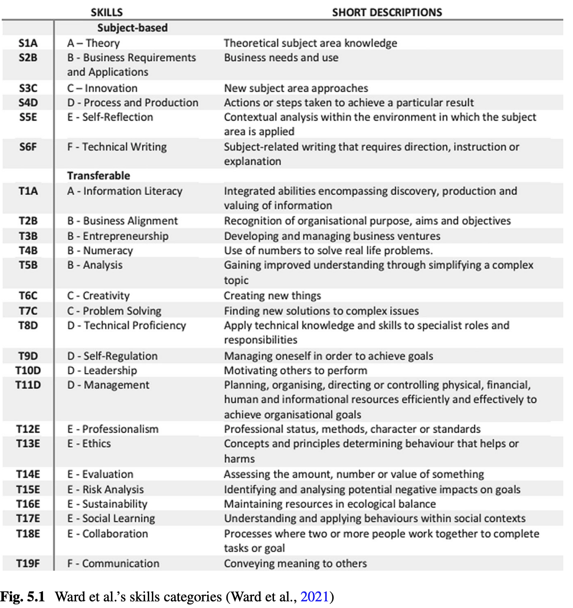
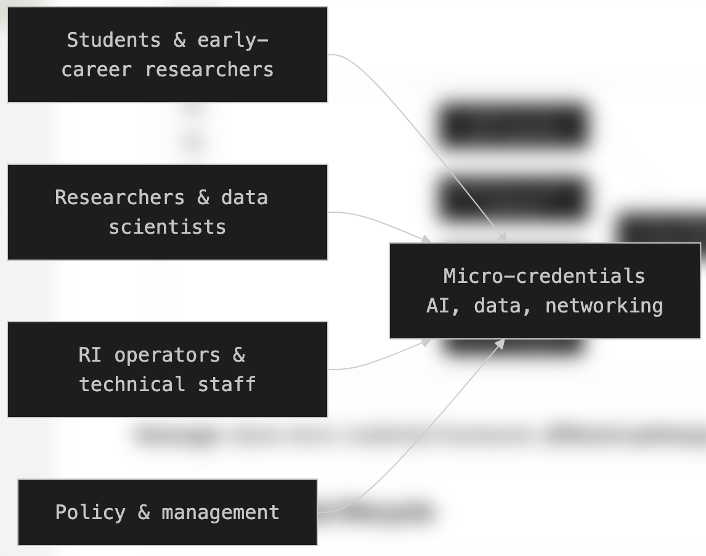
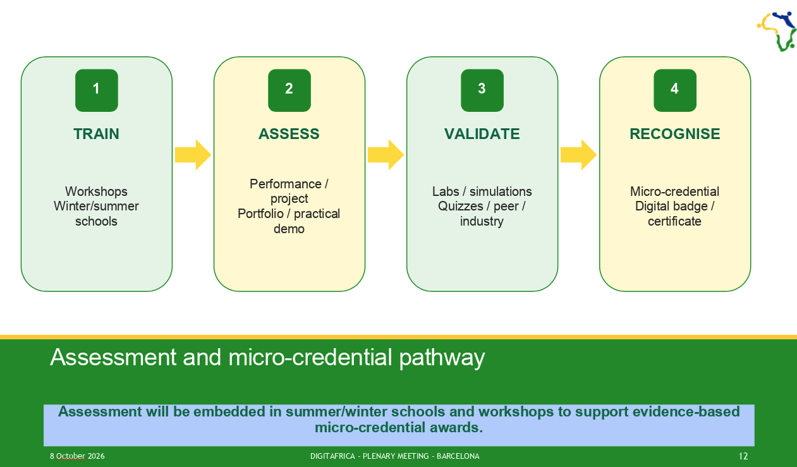
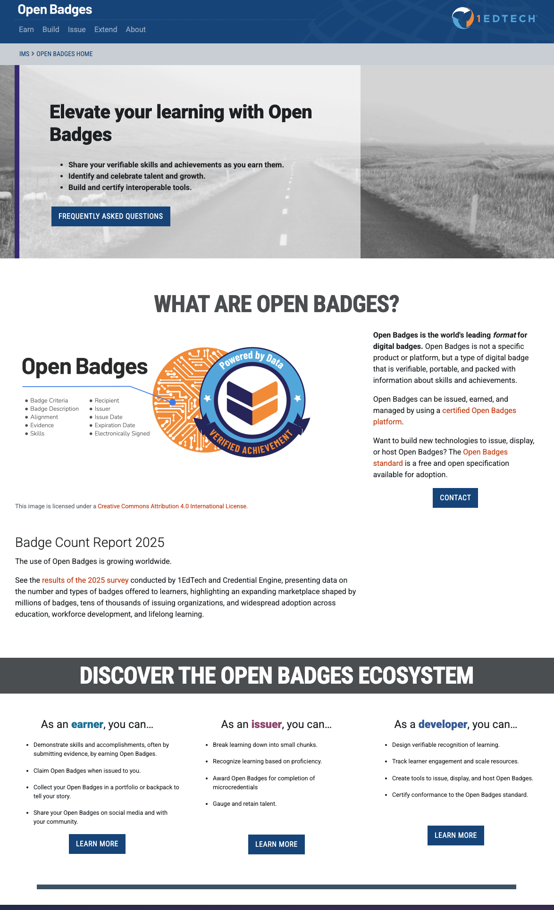

# Microcredentials as a Complement to University Curricula

**Audience:** University lecturers and programme directors  
**Context:** DIGITAfrica - digital skills and research infrastructure

### From standalone learning achievements towards stackable credit

---

## Roadmap of the Talk

- Why microcredentials?
- Learning coverage versus credential signalling
- Five functional types of microcredential use
- Skills Profiling: opportunities and limitations
- Assessment, recognition, and trust
- DIGITAfrica: a standalone starting point and a stackable ambition
- Institutional collaboration and next steps

---

## Why microcredentials now?

- Rapid evolution of **digital technologies and research infrastructures**
- Need to address **specific skills gaps** alongside broader curricula
- Demand for **focused, practice-oriented learning**
- Opportunities to update selected learning units more frequently
- Support for **lifelong learning**, including researchers and professionals

> How can universities offer greater flexibility without losing the depth and coherence of degree programmes?

---

## What is a microcredential?

A microcredential `records` achievement of a **`focused set of learning outcomes`** following a relatively small volume of learning.

It should make clear:

- What the learner is **`expected to achieve`**
- How achievement is **`assessed against defined criteria`**
- The **`workload`** and **`level`**, where applicable
- **`Who`** issued the credential and under what **`quality arrangements`**
- **`How`** the achievement can be verified

> **Stackability and cross-institutional recognition are possible uses-not automatic properties.**

---

## Separate learning coverage from signalling

| Dimension | What it describes | Examples |
|-----------|-------------------|----------|
| **Coverage** | The scope of assessed learning | Programme, course/module, focused component |
| **Credential** | The attestation of achievement | Degree credential, course-level credential, microcredential |
| **Representation** | How achievement is documented | Badge, certificate, verifiable record |

---

## One achievement, different representations

**Microcredential:** the **`defined`** assessed achievement.

**Badge or certificate:** the **`record`** that communicates it.

For DIGITAfrica, we can adopt the convention:

> Each microcredential identifies a defined assessed achievement, documented through a badge, certificate, or equivalent record.

- A `badge` and a `certificate` can represent **the same achievement**.
- Two representations do not create two separate achievements or credits.
- A `participation badge` does not prove assessed learning.

---

## Microcredentials and degrees: complementary roles

**Degree programmes**

- Develop broad disciplinary foundations and academic capabilities
- Integrate learning over a substantial programme
- Operate through established qualification and quality systems

**Microcredentials**

- Recognise `focused` achievements
- Support `targeted` development and `continuing` learning
- Can `complement` programmes when appropriately aligned

> Smaller learning units should strengthen—not fragment—the coherence of education.

---

## Five functional types of microcredential use

Reece (2022), as described in the supplied chapter, distinguishes five approaches:

| Model (Type) | Function |
|---|---|
| **A - Standalone** | Offered independently of a larger qualification |
| **B - Entry** | Supports or satisfies an entry requirement |
| **C - Prior-learning recognition** | Supports recognition of learning already completed |
| **D - Embedded** | Recognises learning aligned with existing course content |
| **E - Stackable credit-bearing** | Provides credit-bearing components of a larger qualification |

---

## Course and programme integration: D and E

**Type D - Embedded recognition**

- Align a focused credential with existing course outcomes.
- Example: a practical cloud-deployment component within a cloud-computing course.
- Embedding does not automatically create additional academic credit.

**Type E - Stackable credit-bearing provision**

- Agree how assessed components contribute to a qualification.
- Define level, workload, credit, and progression requirements.
- Preserve programme coherence and avoid double counting.

---

## External learning: possible uses B, C, and D

External resources can support university learning when their outcomes and evidence are suitable.

- **B - Entry:** a receiving programme accepts an achievement for admission.
- **C - Prior learning:** the institution evaluates previously completed learning.
- **D - Embedded:** selected external resources support an existing course.

**Examples from the chapter**

- LinkedIn Learning: courses and learning paths
- iDEA: challenge-based activities, badges, and awards

> A platform certificate or badge is not automatically a university-recognised microcredential.

---

## Skills Profiling: a bridge between learning and work

`Skills Profiling` maps educational outcomes and employment requirements to **shared skills categories**.

- **Education:** identify the capabilities a course intends to develop and assess.
- **Employment:** identify skills requested in job advertisements.

Ward (2021), uses 
- `Categorise` and `codify` skills 
- Quantify skills coverage through `Skills Hours` 

---
## Skills Profiling: ategorise and codify skills

Categorise and codify skills.
   - Learning outcomes are translated into categories `subject-specific` and `transferable skills`. 
   - This provides a common language for describing educational provision and comparing it with employment requirements

---
## Skills Profiling: Quantify skills coverage through Skills Hours.

Quantify skills coverage through Skills Hours.
- Learning Hours are allocated using:  assessment weights and the outcomes assessed
  - then aggregated by skills category. 
- This shows the relative emphasis given to different skills.

---

## Categorisation is the critical methodological step

Different wording can describe similar capabilities—or hide important differences.

A credible mapping requires:

- Explicit category definitions and coding rules
- Consistent treatment of ambiguous or overlapping outcomes
- Checks on agreement between reviewers
- Transparency about data sources and limitations

For DIGITAfrica:

> Use the competence framework to clarify learning coverage, but validate the mapping and retain evidence of assessment.

---

## Credential signals: three audiences

| Audience | Question the credential helps answer |
|---|-------|
| **Learner** | What have I achieved, and what should I learn next? |
| **Educational institution** | What can we recognise for entry, progression, or credit? |
| **Employer** | What relevant capabilities has this person demonstrated? |

These audiences are **different from the five functional types**.

> The same credential may signal achievement to all three audiences, while recognition decisions remain distinct.

---

## From participation to assessed achievement

Short training **is not automatically a microcredential**.

A practical development pathway:

1. **Participation:** record attendance or engagement.
2. **Defined learning:** specify outcomes and competence alignment.
3. **Assessed achievement:** collect evidence against stated criteria.
4. **Credential award:** issue a verifiable record with clear status.
5. **Recognition:** seek external or academic recognition where appropriate.

> Recognition may develop later; transparent assessment and documentation can begin now.

---

## Assessment: what evidence is sufficient?

Possible methods include:

- Practical demonstrations and deployment tasks
- Projects, case studies, and portfolios
- Quizzes or examinations aligned with outcomes
- Observed problem-solving and documented explanations

Assessment design should specify:

- What counts as successful performance
- Whether individual achievement can be established
- How evidence is reviewed and retained

> Self-assessment supports learning, but is not normally sufficient alone to certify achievement.

---

## Verification, portability, and recognition

These are related, but different:

- **Verification:** is the record authentic, and who issued it?
- **Portability:** can the learner retain and share it?
- **Recognition:** will another organisation accept it for a particular purpose?

Trust is supported by:

- Clear outcomes, workload, and assessment evidence
- Transparent issuer and quality arrangements
- Relevant competence or qualification alignment
- Explicit recognition agreements where needed

> A technically verifiable badge can still lack academic-credit recognition.

---

## DIGITAfrica: purpose remains open

The project does not need to settle every future use now.

**Proposed positioning**

- **Starting point: A - standalone learning provision**
- **Immediate priority: documented, assessed achievements**
- **Longer-term ambition: E - stackable credit-bearing provision**
- **B, C, and D: complementary possibilities requiring partnerships**

> A small project can establish the foundation for recognition without building the entire recognition system.

---

## Example: DIGITAfrica winter school

- Strathmore University, Kenya - March 2026
- Tracks: AI & Big Data; Networking & Cloud Computing
- Blueprint-aligned, hands-on learning and practical sessions
- `Certificates of participation`; no formal assessment implemented

**Interpretation**

- Standalone training provides a starting point aligned with Type A.
- Participation records is not assessed microcredentials.
- Selected activities could be developed into assessed standalone units.

---

## What DIGITAfrica can establish now

For each selected learning unit, document:

- Intended learners and learning outcomes
- Expected workload and  prerequisites
- requirements for successful completion
- Badge/certificate representation and recognition status

> Build a reusable specification that future partners can evaluate.

---

## Platforms support the process—not recognition itself

A delivery environment can support:

- Learning materials and guided practical work
- Assignment submission / assessment evidence
- Learner feedback and quality monitoring
- Credential issuance, verification, and records

 

---

## What moving towards Type E requires

Credit-bearing stackability requires partner **`institution(s)`** to agree on:

- Learning level and qualification alignment
- Workload and credit allocation
- Assessment standards and quality assurance
- Rules for combining components and avoiding double counting
- Award, progression, and recognition procedures

**B, C, and D also need institutional decisions** about admission, prior learning, or curriculum integration.

> These arrangements require time and networking, potentially beyond the project's duration.

---

## Sustainability: a proportionate division of work

**Within DIGITAfrica**

- Reusable curricula, practical environments, and assessment templates
- `Train-the-Trainer` activities and shared learning resources
- Transparent documentation of selected learning achievements

**Through continued partnerships**

- Institutional ownership and quality assurance
- Recognition agreements and credit-bearing pathways
- Continuing delivery, maintenance, and credential services

> Project contribution: establish a foundation that institutions can sustain and extend.

---

## Conclusions

- Microcredentials can **complement**, not replace, degree programmes.
- Separate **learning coverage**, **representation**, and **recognition status**.
- The five functional types provide a vocabulary for future uses.
- DIGITAfrica can begin with standalone achievements aligned with **A**.
- **E** is a longer-term ambition requiring institutional collaboration.
- Assessment and transparent records can begin before formal credit agreements.

> **Start with credible standalone achievements; build the evidence and partnerships needed for future stackable credit.**

---

## Discussion: what can we do next?

- Which DIGITAfrica learning units are suitable for an assessed pilot?
- What evidence would demonstrate individual achievement?
- What information would your institution need to evaluate these units?
- Which future use matters most to your institution: B, C, D, or E?
- What partnership would make that use possible?

> We do not need to decide every future purpose today—but we can identify the next practical collaboration.

---
## example: 

Strathmore University, Kenya — March 2026
- Tracks: Networking & Cloud Computing
- course: Microservice archtecture and Secure authrentication
- Certificates of participation; no formal assessment implemented

  
<!-- -->

---

## example: Step1 - course meta-data

| Course input | Specification |
|--------------|---------------|
| Course | Microservices Architecture & Secure Authentication (JWT) |
| Prerequisite | RESTful API Development with Flask; Python and Linux CLI |
| Scheduled learning | **6 hours: 2 lecture + 4 hands-on lab** |
| Practical environment | Flask, cryptography tools, authentication and shortener services |
| Intended recognition | **Type A - standalone assessed achievement** |

> **Method:** Outcomes → skills codes → assessment weights → Skills Hours → achievement record

---

## example: Step2 - Code the learning outcomes

| Outcome | Assessed action | Proposed subject-specific code |
|---|---|---|
| **LO1** | Split authentication and application services | **S4D** |
| **LO2** | Generate RSA keys; sign and verify data | **S4D** |
| **LO3** | Construct, sign, and verify JWTs | **S4D** |
| **LO4** | Enforce user-specific resource ownership | **S4D** |

**S4D - Process and Production:** actions or steps taken to achieve a particular result.

> All four outcomes emphasise implementation. Categories follow the outcome-not the lecture topic.

---

## example: Step3 -  Specify the assessments

| Proposed assessment | Weight | Outcomes | Evidence |
|---|---:|---|---|
| **A1 - Integrated service practical** | **60%** | LO1, LO2, LO4 | Two services; verified tokens; authorised CRUD; denied cross-user access |
| **A2 - JWT protocol exercise** | **40%** | LO2, LO3 | Key use; token construction; rejection of tampered and expired tokens |

> **Individual evidence:** code + test results + brief demonstration/explanation.
  **Award rule:** satisfactory achievement of **all four outcomes**.

---

## example: Step4 - Calculate outcome Skills Hours

**Allocate six Learning Hours by assessment weighting.**  
**Divide each allocation equally across its assessed outcome entries.**

| Assessment | Weight | Allocated hours | Outcome | Outcome hours | Code |
|----|---:|---:|---|---:|---|
| A1 | 60% | 3.6 | LO1 | 1.2 | S4D |
| A1 | - | - | LO2 | 1.2 | S4D |
| A1 | - | -| LO4 | 1.2 | S4D |
| A2 | 40% | 2.4 | LO2 | 1.2 | S4D |
| A2 | - | - | LO3 | 1.2 | S4D |
| **Total** | **100%** | **6.0** | | **6.0** | |

---

## example: Step5 - Aggregate the Skills Profile

| Learning outcome | Contributions | Skills Hours |
|---|---|---:|
| LO1 - Service decomposition | A1 | 1.2 |
| LO2 - RSA signing/verification | A1 + A2 | 2.4 |
| LO3 - JWT mechanics | A2 | 1.2 |
| LO4 - Resource ownership | A1 | 1.2 |
| **Total** | | **6.0** |

| Subject-specific category | Skills Hours | Profile share |
|---|---:|---:|
| **S4D - Process and Production** | **6.0** | **100%** |

> Repeated assessment of LO2 changes its allocation-not the module's total hours.

---

## 5. Interpret the result

| The profile shows | The profile does not show |
|---|---|
| Implementation-focused assessed outcomes | Six measurable hours of proficiency |
| Greater allocated emphasis on LO2 | Actual time spent on each task |
| Broad subject-specific coverage | Production readiness or academic credit |

>**Keep the technical outcomes and evidence alongside the codes.**
**If theory is an intended achievement:** define and assess an explicit theoretical outcome → consider **S1A** → recalculate.

---

## 6. Identify transferable skills

**One outcome may map to several transferable categories.**
| Outcome | Candidate category | Evidence needed |
|---|---|---|
| LO1 | **T8D - Technical Proficiency** | Service implementation |
| LO1 | **T5B - Analysis** | Assessed decomposition reasoning |
| LO2, LO3 | **T8D - Technical Proficiency** | Key operations and JWT implementation |
| LO3 | **T5B - Analysis** | Assessed interpretation of protocol behaviour |
| LO4 | **T8D - Technical Proficiency** | Ownership enforcement |
| LO4 | **T15E - Risk Analysis** | Explicit analysis of access-control threats |

---

## 7. Make the security claims accurate

| Course wording/design | Required clarification |
|---|---|
| "RSA-256" | Use **RS256: RSA signature with SHA-256** |
| Plain SHA-256 password hashing | Use a salted password-hashing scheme: **Argon2id, scrypt, or bcrypt** |
| Manual JWT construction | **Educational exercise**, not recommended production implementation |
| Token verification | Check allowed algorithm, signature, expiry, and relevant claims |
| Multi-user security | Enforce ownership separately from authentication |

> Skills coding does not establish that an implementation is secure.

---

## 8. Signal the standalone achievement

| Credential field | Proposed record |
|---|---|
| Achievement | Two-service application with JWT verification and user-specific access control |
| Conditions | Educational lab; supplied scaffold; individual assessment |
| Skills Profile | **S4D: 6 subject-specific Skills Hours** under the proposed specification |
| Representation | Badge, certificate, or equivalent verifiable record |
| Recognition status | **Type A; no academic credit claimed** |

**One achievement → one award record → potentially several representations.**

> Type E remains a future institutional possibility. Types B, C, and D are not pilot commitments.

---

## 9. Takeaway: a practical DIGITAfrica workflow

| Step | Pilot output |
|---|---|
| Define | Four assessable learning outcomes |
| Codify | Proposed **S4D** mappings |
| Weight | Proposed assessments: **60% / 40%** |
| Calculate | **6 subject-specific Skills Hours** |
| Assess | Individual evidence for all outcomes |
| Signal | Transparent **Type A** achievement record |

**Next step:** instructor review of codes, weightings, workload, and assessment evidence.

## References

- DIGITAfrica D4.2: Competence Framework nd Modular Curricula*. Version 1.0, 2026. https://www.digitafrica.eu/wp-content/uploads/2026/07/DIGITAfrica_D4.2_v1.0.pdf

- R. Ward and S. Grant on the Universal Microcredential Framework, Skills Profiling, and credential signalling. DOI: 10.1109/TE.2024.3486016   
