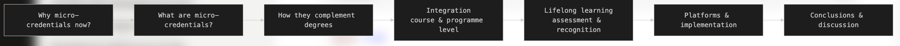
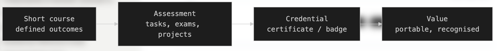
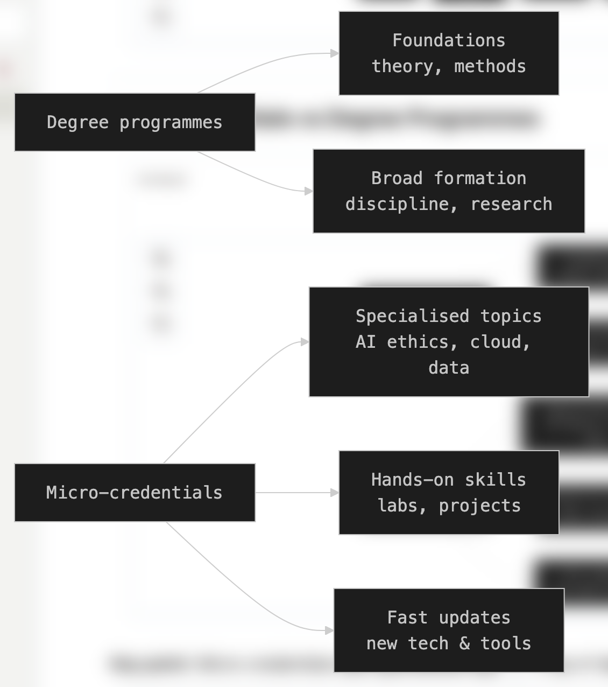
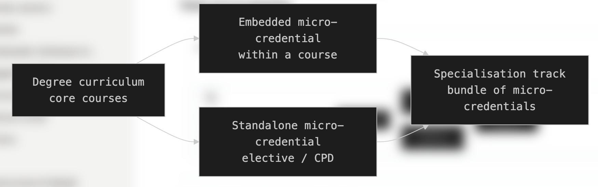
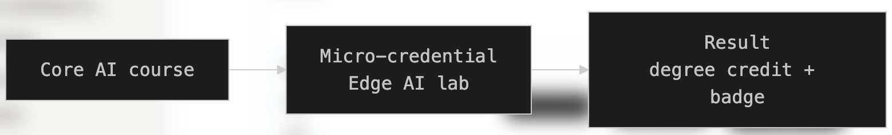
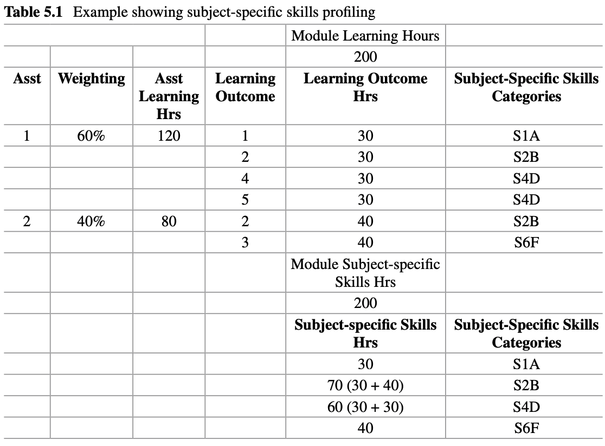
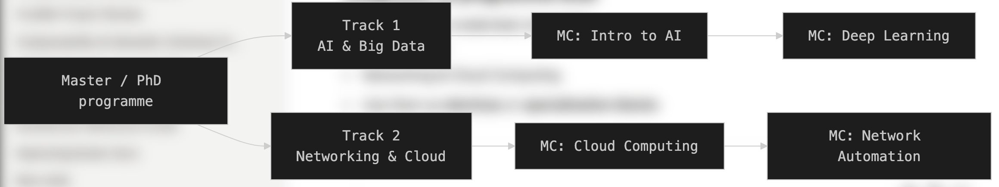
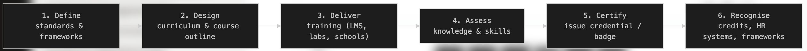
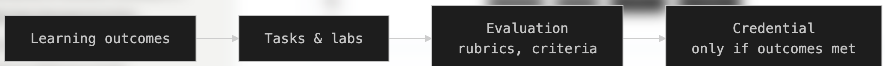

# Microcredentials as a Complement to University Curricula

**Audience:** University lecturers and programme directors  
**Context:** DIGITAfrica — digital skills and research infrastructure

### From standalone learning achievements towards stackable credit

---

## Roadmap of the Talk

- Why microcredentials?
- Learning coverage versus credential signalling
- Five functional types of microcredential use
- Skills Profiling: opportunities and limitations
- Assessment, recognition, and trust
- DIGITAfrica: a standalone starting point and a stackable ambition
- Institutional collaboration and next steps

---

## Why microcredentials now?

- Rapid evolution of **digital technologies and research infrastructures**
- Need to address **specific skills gaps** alongside broader curricula
- Demand for **focused, practice-oriented learning**
- Opportunities to update selected learning units more frequently
- Support for **lifelong learning**, including researchers and professionals

> How can universities offer greater flexibility without losing the depth and coherence of degree programmes?

---

## What is a microcredential?

A microcredential `records` achievement of a **`focused set of learning outcomes`** following a relatively small volume of learning.

It should make clear:

- What the learner is **`expected to achieve`**
- How achievement is **`assessed against defined criteria`**
- The **`workload`** and **`level`**, where applicable
- **`Who`** issued the credential and under what **`quality arrangements`**
- **`How`** the achievement can be verified

<!---
> **Stackability and cross-institutional recognition are possible uses—not automatic properties.**

--->

<!-- Speaker note: This is a working explanation, not a quotation from a formal definition. Small volume is contextual: microcredentials are not necessarily advanced, university-credit-bearing, or assignment-sized. -->

---

## Separate learning coverage from signalling

| Dimension | What it describes | Examples |
|-----------|-------------------|----------|
| **Coverage** | The scope of assessed learning | Programme, course/module, focused component |
| **Credential** | The attestation of achievement | Degree credential, course-level credential, microcredential |
| **Representation** | How achievement is documented | Badge, certificate, verifiable record |

<!---
> **A badge is not inherently a smaller learning unit than a microcredential. It can represent one.**
--->

<!-- Speaker note: Credential is the umbrella term. The coverage examples are a practical design guide, not a universal hierarchy. A microcredential may cover an entire short course. An assignment is an assessment instrument, not automatically a credential. -->

---

## One achievement, different representations

**Microcredential:** the **`defined`** assessed achievement.

**Badge or certificate:** the **`record`** that communicates it.

For DIGITAfrica, we can adopt the convention:

> Each microcredential identifies a defined assessed achievement, documented through a badge, certificate, or equivalent record.

- A `badge` and a `certificate` can represent **the same achievement**.
- Two representations do not create two separate achievements or credits.
- A `participation badge` does not prove assessed learning.

<!-- Speaker note: If we use one badge per microcredential, that is our issuing convention—not a universal rule about badges. -->

---

## Microcredentials and degrees: complementary roles

**Degree programmes**

- Develop broad disciplinary foundations and academic capabilities
- Integrate learning over a substantial programme
- Operate through established qualification and quality systems

**Microcredentials**

- Recognise `focused` achievements
- Support `targeted` development and `continuing` learning
- Can `complement` programmes when appropriately aligned

> Smaller learning units should strengthen—not fragment—the coherence of education.

<!--

-->

---

## Five functional types of microcredential use

Reece (2022), as described in the supplied chapter, distinguishes five approaches:

| Model (Type) | Function |
|---|---|
| **A — Standalone** | Offered independently of a larger qualification |
| **B — Entry** | Supports or satisfies an entry requirement |
| **C — Prior-learning recognition** | Supports recognition of learning already completed |
| **D — Embedded** | Recognises learning aligned with existing course content |
| **E — Stackable credit-bearing** | Provides credit-bearing components of a larger qualification |

<!-- Speaker note: The source calls these models. Here we use functional types because the distinction concerns use. The original Reece reference needs bibliographic verification. -->

<!--
---

## Why call them “types” rather than “models”?

They describe **what a microcredential is used for**.

- They do not define subject content or learning level.
- They are not five requirements every microcredential must satisfy.
- They can overlap: a standalone credential may later support prior-learning recognition.
- They are **not a compulsory development sequence**.

> DIGITAfrica can start with A and work towards E without first implementing B, C, and D.
-->

<!-- Speaker note: Entry recognition may support admission without being a mandatory prerequisite. Recognition depends on the receiving institution. -->

---

## Course and programme integration: D and E

**Type D — Embedded recognition**

- Align a focused credential with existing course outcomes.
- Example: a practical cloud-deployment component within a cloud-computing course.
- Embedding does not automatically create additional academic credit.

**Type E — Stackable credit-bearing provision**

- Agree how assessed components contribute to a qualification.
- Define level, workload, credit, and progression requirements.
- Preserve programme coherence and avoid double counting.

<!--
> Academic credit requires institutional approval; it does not follow from issuing a badge.

-->

---

## External learning: possible uses B, C, and D

External resources can support university learning when their outcomes and evidence are suitable.

- **B — Entry:** a receiving programme accepts an achievement for admission.
- **C — Prior learning:** the institution evaluates previously completed learning.
- **D — Embedded:** selected external resources support an existing course.

**Examples from the chapter**

- LinkedIn Learning: courses and learning paths
- iDEA: challenge-based activities, badges, and awards

> A platform certificate or badge is not automatically a university-recognised microcredential.

<!-- Speaker note: A coherent collection of external resources can support a skills profile. Its credential and recognition status must still be established. Credit-bearing incorporation would also involve Type E arrangements. -->

---

## Skills Profiling: a bridge between learning and work

`Skills Profiling` maps educational outcomes and employment requirements to **shared skills categories**.

- **Education:** identify the capabilities a course intends to develop and assess.
- **Employment:** identify skills requested in job advertisements.

Ward (2021), uses 
- `Categorise` and `codify` skills 
- Quantify skills coverage through `Skills Hours` 

<!--
> Common categories make comparison possible; they do not by themselves establish equivalence.

-->

<!-- Speaker note: Job advertisements express requested skills, not direct measurements of workplace competency. Intended outcomes, assessed achievement, and workplace performance must remain distinguishable. -->

---
## Skills Profiling: ategorise and codify skills

Categorise and codify skills.
   - Learning outcomes are translated into categories `subject-specific` and `transferable skills`. 
   - This provides a common language for describing educational provision and comparing it with employment requirements

---
## Skills Profiling: Quantify skills coverage through Skills Hours.

Quantify skills coverage through Skills Hours.
- Learning Hours are allocated using:  assessment weights and the outcomes assessed
  - then aggregated by skills category. 
- This shows the relative emphasis given to different skills.

---

## Categorisation is the critical methodological step

Different wording can describe similar capabilities—or hide important differences.

A credible mapping requires:

- Explicit category definitions and coding rules
- Consistent treatment of ambiguous or overlapping outcomes
- Checks on agreement between reviewers
- Transparency about data sources and limitations

For DIGITAfrica:

> Use the competence framework to clarify learning coverage, but validate the mapping and retain evidence of assessment.

<!-- Speaker note: DIGITAfrica contextualises established competence frameworks for digital research infrastructures. A shared vocabulary helps alignment, but should not erase differences in level, context, or assessment. -->

---

## Credential signals: three audiences

| Audience | Question the credential helps answer |
|---|-------|
| **Learner** | What have I achieved, and what should I learn next? |
| **Educational institution** | What can we recognise for entry, progression, or credit? |
| **Employer** | What relevant capabilities has this person demonstrated? |

These audiences are **different from the five functional types**.

> The same credential may signal achievement to all three audiences, while recognition decisions remain distinct.

<!-- >

---

## Trust: useful analogy, important limits

The chapter compares hours, badges, microcredentials, and degrees to units of currency.

**Useful insight**

- Clear units and trustworthy records can make recognition more manageable.
- A coherent assessed package may be easier to evaluate than many unrelated badges.

**Limit of the analogy**

- Equal hours do not mean equal learning level or achievement.
- Badges are not inherently low-value “coins”.
- Adding hours or badges does not automatically produce credit or a degree.

> Trust requires assessment, quality assurance, and recognition agreements—not just a common measure.

---

## From participation to assessed achievement

Short training **is not automatically a microcredential**.

A practical development pathway:

1. **Participation:** record attendance or engagement.
2. **Defined learning:** specify outcomes and competence alignment.
3. **Assessed achievement:** collect evidence against stated criteria.
4. **Credential award:** issue a verifiable record with clear status.
5. **Recognition:** seek external or academic recognition where appropriate.

> Recognition may develop later; transparent assessment and documentation can begin now.

---

## Assessment: what evidence is sufficient?

Possible methods include:

- Practical demonstrations and deployment tasks
- Projects, case studies, and portfolios
- Quizzes or examinations aligned with outcomes
- Observed problem-solving and documented explanations

Assessment design should specify:

- What counts as successful performance
- Whether individual achievement can be established
- How evidence is reviewed and retained

> Self-assessment supports learning, but is not normally sufficient alone to certify achievement.

---

## Verification, portability, and recognition

These are related, but different:

- **Verification:** is the record authentic, and who issued it?
- **Portability:** can the learner retain and share it?
- **Recognition:** will another organisation accept it for a particular purpose?

Trust is supported by:

- Clear outcomes, workload, and assessment evidence
- Transparent issuer and quality arrangements
- Relevant competence or qualification alignment
- Explicit recognition agreements where needed

> A technically verifiable badge can still lack academic-credit recognition.

<!-- Speaker note: Mapping to e-CF, EQF, or ACQF may support interpretation, but these frameworks have different purposes. Mapping alone does not guarantee cross-border recognition. Private providers can also issue credible credentials; issuer transparency and quality matter. -->

---

## DIGITAfrica: purpose remains open

The project does not need to settle every future use now.

**Proposed positioning**

- **Starting point: A — standalone learning provision**
- **Immediate priority: documented, assessed achievements**
- **Longer-term ambition: E — stackable credit-bearing provision**
- **B, C, and D: complementary possibilities requiring partnerships**

> A small project can establish the foundation for recognition without building the entire recognition system.

<!-- Speaker note: This is a proposed development strategy, not a claim that formal microcredentials or transferable academic credits have already been established. -->

---

## Example: DIGITAfrica winter school

- Strathmore University, Kenya — March 2026
- Tracks: AI & Big Data; Networking & Cloud Computing
- Blueprint-aligned, hands-on learning and practical sessions
- `Certificates of participation`; no formal assessment implemented

**Interpretation**

- Standalone training provides a starting point aligned with Type A.
- Participation records is not assessed microcredentials.
- Selected activities could be developed into assessed standalone units.

<!-- Speaker note: Confirm the event details and assessment status against project records before delivery. Type A describes the standalone positioning; it does not mean the event already awarded microcredentials. -->

---

## What DIGITAfrica can establish now

For each selected learning unit, document:

- Intended learners and learning outcomes
- Expected workload and  prerequisites
- requirements for successful completion
- Badge/certificate representation and recognition status

> Build a reusable specification that future partners can evaluate.

<!-- Speaker note: The example is a candidate, not a claim about an existing accredited unit. Potential combinations can be documented without claiming approved credit-bearing stacks. -->

---

## Platforms support the process—not recognition itself

A delivery environment can support:

- Learning materials and guided practical work
- Assignment submission / assessment evidence
- Learner feedback and quality monitoring
- Credential issuance, verification, and records

 

<!-- Speaker note: Issuance and LMS functions may require separate integrations. This slide describes capabilities to develop or connect, not a verified end-to-end credential system already deployed. -->

---

## What moving towards Type E requires

Credit-bearing stackability requires partner **`institution(s)`** to agree on:

- Learning level and qualification alignment
- Workload and credit allocation
- Assessment standards and quality assurance
- Rules for combining components and avoiding double counting
- Award, progression, and recognition procedures

**B, C, and D also need institutional decisions** about admission, prior learning, or curriculum integration.

> These arrangements require time and networking, potentially beyond the project's duration.

---

## Sustainability: a proportionate division of work

**Within DIGITAfrica**

- Reusable curricula, practical environments, and assessment templates
- `Train-the-Trainer` activities and shared learning resources
- Transparent documentation of selected learning achievements

**Through continued partnerships**

- Institutional ownership and quality assurance
- Recognition agreements and credit-bearing pathways
- Continuing delivery, maintenance, and credential services

> Project contribution: establish a foundation that institutions can sustain and extend.

<!-- Speaker note: This is a proposed division of responsibilities. Do not present an unapproved funding or sustainability arrangement as settled project policy. -->

---

## Conclusions

- Microcredentials can **complement**, not replace, degree programmes.
- Separate **learning coverage**, **representation**, and **recognition status**.
- The five functional types provide a vocabulary for future uses.
- DIGITAfrica can begin with standalone achievements aligned with **A**.
- **E** is a longer-term ambition requiring institutional collaboration.
- Assessment and transparent records can begin before formal credit agreements.

> **Start with credible standalone achievements; build the evidence and partnerships needed for future stackable credit.**

---

## Discussion: what can we do next?

- Which DIGITAfrica learning units are suitable for an assessed pilot?
- What evidence would demonstrate individual achievement?
- What information would your institution need to evaluate these units?
- Which future use matters most to your institution: B, C, D, or E?
- What partnership would make that use possible?

> We do not need to decide every future purpose today—but we can identify the next practical collaboration.

---

## References

- DIGITAfrica D4.2: Competence Framework nd Modular Curricula*. Version 1.0, 2026. https://www.digitafrica.eu/wp-content/uploads/2026/07/DIGITAfrica_D4.2_v1.0.pdf

- R. Ward and S. Grant on the Universal Microcredential Framework, Skills Profiling, and credential signalling. DOI: 10.1109/TE.2024.3486016   

<!-- Before delivery: verify the D4.2 title, version, date, and URL. Add the complete chapter citation and the original Reece (2022) reference from the publication's bibliography. Those details have not been independently verified here. Do not imply that the original Reece publication was consulted. -->
